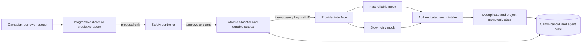
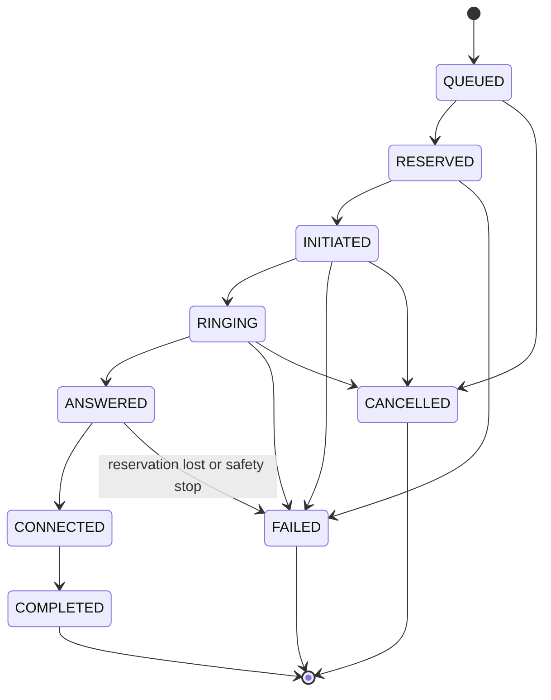

# GitHub Mermaid diagrams

These are three separate Mermaid blocks. Keep each opening and closing fence exactly as shown when pasting into a Markdown file such as `README.md`. The `.mmd` companion files contain only raw Mermaid source and should be opened/rendered individually, not pasted inside another Mermaid fence.

## Architecture

## Agent lifecycle

```mermaid
stateDiagram-v2
  [*] --> OFFLINE
  OFFLINE --> AVAILABLE: login
  AVAILABLE --> RESERVED: atomic claim
  RESERVED --> DIALING: initiate call
  DIALING --> CONNECTED: answer on reserved slot
  DIALING --> AVAILABLE: definitive failure or cancel
  CONNECTED --> WRAP_UP: call complete
  WRAP_UP --> AVAILABLE: wrap-up elapsed
  AVAILABLE --> PAUSED: agent pause
  PAUSED --> AVAILABLE: resume
  AVAILABLE --> OFFLINE: logout
  DIALING --> DIALING: timeout; hold slot and reconcile
```

## Call lifecycle

